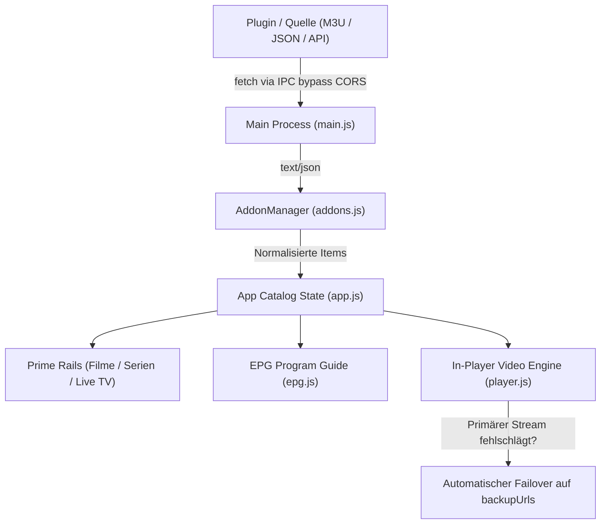
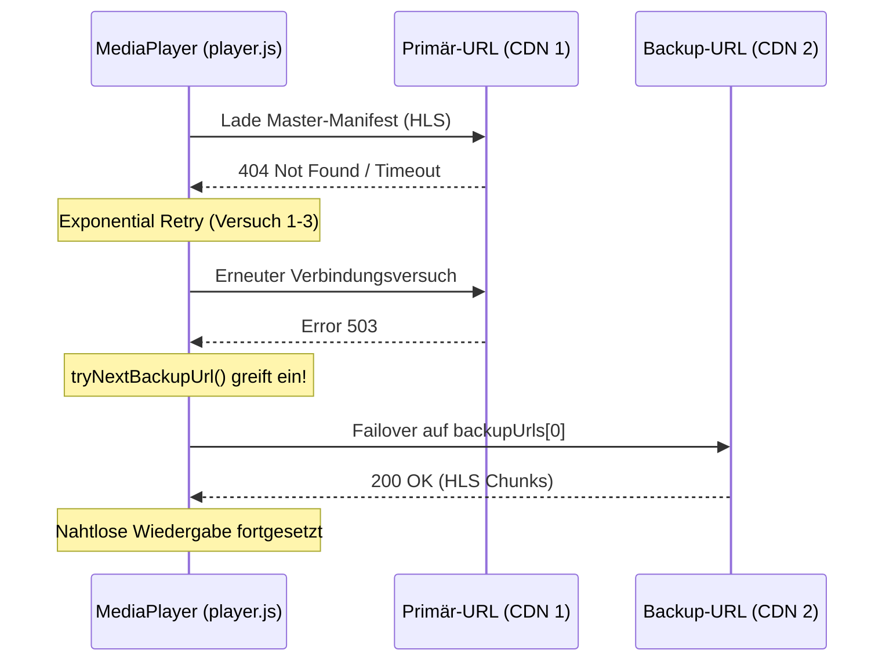

# 🧩 PrimeNexus Plugin- & Add-on-Entwicklungsleitfaden

Dieser Leitfaden beschreibt detailliert, wie du für den **PrimeNexus Media Player** eigene Add-ons und Bibliotheks-Plugins entwickelst, bereitstellst und einbindest.

---

## 📑 Inhaltsverzeichnis
1. [Architekturüberblick](#1-architekturüberblick)
2. [Unterstützte Plugin-Typen](#2-unterstützte-plugin-typen)
3. [Typ A: Remote JSON-Katalog (Empfohlen)](#3-typ-a-remote-json-katalog)
4. [Typ B: M3U8 / IPTV Live-Playlist](#4-typ-b-m3u8--iptv-live-playlist)
5. [Typ C: Programmatischer Custom Provider (JS-Scraper / Feed-Resolver)](#5-typ-c-programmatischer-custom-provider)
6. [Kanalnummerierung & Failover-Streams (Backup-URLs)](#6-kanalnummerierung--failover-streams)
7. [Testing & Lokale Einbindung](#7-testing--lokale-einbindung)
8. [Best Practices & Checkliste](#8-best-practices--checkliste)

---

## 1. Architekturüberblick

PrimeNexus trennt strikt zwischen Benutzeroberfläche (**Renderer**), Sicherheitsumgebung (**Electron Main / Preload**) und den **Inhaltsquellen** (**Add-ons / Plugins**).



### Kernregeln für Plugins:
- **Kein Browser-Overhead**: Plugins liefern strukturierte Medienmetadaten und direkte Stream-URLs (`.m3u8`, `.mp4`, `.webm`).
- **Zweisprachigkeit**: Titel und Beschreibungen sollten idealerweise auf Deutsch (`_de`) und Ungarisch (`_hu`) hinterlegt werden.
- **Failover-Sicherheit**: Jeder Sender bzw. Film kann ein Array von `backupUrls` besitzen. Fällt die Primär-URL aus, wechselt der Player nahtlos zum nächsten Spiegelserver.

---

## 2. Unterstützte Plugin-Typen

| Typ | Kennung | Verwendung | Vorteil |
|---|---|---|---|
| **JSON Catalog** | `json_feed` | Ganze Film-/Serien-Kataloge, VOD-Bibliotheken | Reichhaltige Metadaten, Staffeln, Episoden, Backdrops |
| **M3U / IPTV** | `m3u` | TV-Senderlisten, Web-TV, Radiosender | Extrem einfach, universeller Standard (`#EXTINF`) |
| **Custom Provider** | `custom_js` | Eigene APIs, dynamische Token-Generierung | Maximale Flexibilität für komplexe Web-Endpunkte |

---

## 3. Typ A: Remote JSON-Katalog

Ein JSON-Feed ist das leistungsfähigste Format für Filme und mehrteilige Serien. Du kannst diese JSON-Datei auf GitHub Pages, einem eigenen Server oder als Gist hosten.

### Schema: `plugin-manifest.json`

```json
{
  "$schema": "https://primenexus.local/schemas/plugin-v2.json",
  "name": "SciFi & Classic Cinema Archive",
  "version": "1.2.0",
  "description": "Öffentlich zugängliche gemeinfreie Film- und Serienklassiker",
  "author": "Open Media Foundation",
  "language": "multi",
  "items": [
    {
      "id": "movie-night-living-dead",
      "type": "movie",
      "title_de": "Die Nacht der lebenden Toten (1968)",
      "title_hu": "Az élőhalottak éjszakája (1968)",
      "description_de": "George A. Romeros Horrorklassiker im Public Domain Archiv.",
      "description_hu": "George A. Romero műfajteremtő klasszikus horrorfilmje.",
      "category": "movies",
      "language": "multi",
      "rating": "8.0",
      "year": "1968",
      "duration": "1 Std. 36 Min.",
      "poster": "https://images.unsplash.com/photo-1509198397868-475647b2a1e5?w=800",
      "streamUrl": "https://ia800300.us.archive.org/1/items/night_of_the_living_dead/night_of_the_living_dead_512kb.mp4",
      "backupUrls": [
        "https://archive.org/download/night_of_the_living_dead/night_of_the_living_dead.mp4"
      ],
      "format": "mp4",
      "isLive": false
    },
    {
      "id": "series-cosmos-odyssey",
      "type": "series",
      "title_de": "Kosmische Horizonte",
      "title_hu": "Kozmikus Horizontok",
      "description_de": "Dokumentarserie über Astronomie und Raumfahrt.",
      "description_hu": "Dokumentumfilm-sorozat a csillagászatról és űrkutatásról.",
      "category": "docs",
      "language": "de",
      "rating": "9.1",
      "year": "2024",
      "poster": "https://images.unsplash.com/photo-1451187580459-43490279c0fa?w=800",
      "episodes": [
        {
          "id": "cosmos-s01e01",
          "season": 1,
          "episode": 1,
          "title_de": "S1 E1: Die Geburt der Sterne",
          "title_hu": "1.É 1.R: A csillagok születése",
          "description_de": "Wie Sterne und Planetensysteme entstehen.",
          "description_hu": "Hogyan jönnek létre a csillagok és bolygórendszerek.",
          "duration": "24 Min.",
          "streamUrl": "https://commondatastorage.googleapis.com/gtv-videos-bucket/sample/TearsOfSteel.mp4",
          "backupUrls": [
            "https://test-streams.mux.dev/x36xhzz/x36xhzz.m3u8"
          ],
          "format": "mp4",
          "poster": "https://images.unsplash.com/photo-1446776811953-b23d57bd21aa?w=600"
        }
      ]
    }
  ]
}
```

---

## 4. Typ B: M3U8 / IPTV Live-Playlist

Wenn du eine ganze TV-Senderlandschaft bereitstellen möchtest, ist das M3U-Format ideal. PrimeNexus liest Metadaten aus dem `#EXTINF`-Header automatisch aus.

### Beispiel: `playlist.m3u`

```text
#EXTM3U x-tvg-url="https://epg.example.com/epg.xml"

#EXTINF:-1 tvg-id="DasErste.de" tvg-name="Das Erste" tvg-logo="https://upload.wikimedia.org/wikipedia/commons/thumb/e/e0/Das_Erste_Logo_2015.svg/500px-Das_Erste_Logo_2015.svg.png" group-title="Öffentlich-Rechtlich" tvg-chno="1",Das Erste HD
#EXTVLCOPT:backup-url=https://mcdn.daserste.de/daserste/de/master.m3u8
https://mcdn.daserste.de/daserste/de/master_low.m3u8

#EXTINF:-1 tvg-id="ZDF.de" tvg-name="ZDF" tvg-logo="https://upload.wikimedia.org/wikipedia/commons/thumb/6/67/ZDF_logo.svg/500px-ZDF_logo.svg.png" group-title="Öffentlich-Rechtlich" tvg-chno="2",ZDF HD
https://zdf-hls-15.akamaized.net/hls/live/2016498/de/veryhigh/master.m3u8

#EXTINF:-1 tvg-id="Duna.hu" tvg-name="Duna TV" tvg-logo="https://upload.wikimedia.org/wikipedia/commons/thumb/d/d4/Duna_logo_2012.svg/500px-Duna_logo_2012.svg.png" group-title="Magyar" tvg-chno="1",Duna Televízió Élő
https://stream.y5.hu/stream/duna/master.m3u8
```

### Unterstützte M3U-Attribute:
- `tvg-chno`: Legt die **feste Kanalnummer** (z. B. `1` für Das Erste) fest.
- `tvg-logo`: URL für das Senderlogo / Poster.
- `group-title`: Wird zur Genre-/Kategorie-Zuordnung (`news`, `movies`, `sports`, `docs`) verwendet.
- `#EXTVLCOPT:backup-url`: Registriert Failover-Streams.

---

## 5. Typ C: Programmatischer Custom Provider

Für APIs mit dynamischen Tokens, Scraper oder Mediathek-Schnittstellen kannst du einen JavaScript-Provider in `renderer/addons.js` registrieren.

### Provider-Schnittstelle (`IPluginProvider`)

```javascript
class MediathekPluginProvider {
  constructor(config) {
    this.id = config.id || 'plugin-mediathek-custom';
    this.name = 'Öffentliche Mediathek API';
    this.version = '1.0.0';
    this.endpoint = config.url || 'https://api.example.com/v1/highlights';
  }

  /**
   * Lädt die Inhalte und gibt sie als normalisiertes Array zurück.
   */
  async fetchItems() {
    try {
      // IPC-Bypass gegen CORS
      const res = await window.electronAPI.fetchRemote(this.endpoint);
      if (!res.success) throw new Error(res.error);

      const payload = JSON.parse(res.text);

      return payload.results.map((entry, index) => ({
        id: `${this.id}-${entry.guid || index}`,
        type: entry.isLive ? 'livetv' : 'movie',
        title_de: entry.titleGerman || entry.title,
        title_hu: entry.titleHungarian || entry.title,
        description_de: entry.synopsisDe || '',
        description_hu: entry.synopsisHu || '',
        category: this.mapCategory(entry.genre),
        language: entry.lang || 'de',
        streamUrl: entry.primaryPlaybackUrl,
        backupUrls: entry.mirrors || [],
        format: entry.primaryPlaybackUrl.endsWith('.m3u8') ? 'hls' : 'mp4',
        poster: entry.thumbnail,
        rating: entry.rating || '8.5',
        year: entry.releaseYear || '2024',
        isLive: !!entry.isLive
      }));
    } catch (err) {
      console.error(`Fehler in Plugin ${this.name}:`, err);
      return [];
    }
  }

  mapCategory(genre) {
    if (/nachrichten|news/i.test(genre)) return 'news';
    if (/doku|wissen/i.test(genre)) return 'docs';
    if (/animation|kinder/i.test(genre)) return 'animation';
    return 'movies';
  }
}
```

---

## 6. Kanalnummerierung & Failover-Streams

### 🔢 1. Feste Kanalnummerierung (`fixedChannelNumber`)
Damit ein Sender wie am echten Fernseher auf einem festen Kanalplatz liegt, muss das Feld `fixedChannelNumber` bzw. das Attribut `tvg-chno` gesetzt werden:

```json
{
  "id": "livetv-das-erste",
  "fixedChannelNumber": 1,
  "title_de": "Das Erste (ARD)",
  "language": "de",
  "isLive": true
}
```
*Ergebnis:* Der Sender erscheint als `[CH 01]` und kann im Player direkt mit Taste <kbd>1</kbd> angesprungen werden.

### 🛡️ 2. Automatische Failover-Strategie (`backupUrls`)
Wenn ein Stream abbricht oder der Server überlastet ist, schaltet PrimeNexus automatisch um:



---

## 7. Testing & Lokale Einbindung

### Schritt 1: Lokale Test-Datei bereitstellen
1. Erstelle eine Datei `my-plugin.json` auf deiner Festplatte oder lade sie auf GitHub / Pastebin hoch.
2. Starte die Anwendung:
   ```powershell
   npm start
   ```

### Schritt 2: Im Player laden
1. Klicke in der oberen Menüleiste auf **„Bibliotheken & Add-ons“**.
2. Wechsle auf den Tab **„+ Neue Bibliothek / Add-on“**.
3. Trage deinen Namen ein und füge die URL (oder den Pfad zur Datei) ein.
4. Klicke auf **„Bibliothek laden & aktivieren“**.
5. Prüfe in der Konsole (<kbd>Strg</kbd> + <kbd>Umschalt</kbd> + <kbd>I</kbd>), ob alle Einträge erfolgreich synchronisiert wurden.

---

## 8. Best Practices & Checkliste

- [ ] **HTTPS verwenden**: Alle Stream- und Poster-URLs sollten `https://` nutzen, um Mixed-Content-Warnungen zu vermeiden.
- [ ] **CORS-Unabhängigkeit**: Nutze `window.electronAPI.fetchRemote()`, um Web-Feeds ohne Browser-CORS-Sperren abzufragen.
- [ ] **Robuste Thumbnails**: Falls ein Vorschaubild offline geht, fängt `onerror` im Template das Bild automatisch mit einem Fallback ab.
- [ ] **Legale Quellen**: Binde ausschließlich autorisierte, frei zugängliche Medien (wie Mediatheken, Public-Domain-Archive oder freie Web-Streams) ein.


## 9. SerienStream-Metadaten-Bridge (lokal)

Für die C#-Bibliothek [IcySnex/SerienStreamAPI](https://github.com/IcySnex/SerienStreamAPI) liegt unter `tools/SerienStreamBridge` eine lokale .NET-8-Bridge. Sie stellt Serien-Stammdaten und Episodentitel als JSON bereit, das der vorhandene `json_feed`-Parser lesen kann.

### Start

```bash
cd tools/SerienStreamBridge
dotnet restore
dotnet run
```

Die Bridge lauscht nur auf `127.0.0.1:4317`. Danach kann in PrimeNexus unter **Bibliotheken & Add-ons → Neue Bibliothek / Add-on** der Add-on-Typ **SerienStreamAPI – Serien-Metadaten (lokale Bridge)** gewählt werden. Titel und Katalogtyp werden im Formular eingetragen; PrimeNexus erstellt die lokale Feed-URL automatisch. Alternativ kann der JSON-Feed direkt mit folgender URL angelegt werden:

```
http://127.0.0.1:4317/catalog?title=My%20Series&site=serie
```

Für Anime wird `site=anime` verwendet. Der genaue Titel muss auf der ausgewählten Website auffindbar sein. Mehrere Serien können als mehrere Add-ons angelegt werden.

**Wiedergabe:** Die Bridge liefert bewusst nur Metadaten. Episoden ohne direkte, autorisierte Medien-URL werden in der Serienansicht als **Nur Metadaten** angezeigt und sind nicht anklickbar. Die Bridge ruft keine Video-Hoster-Resolver auf.
